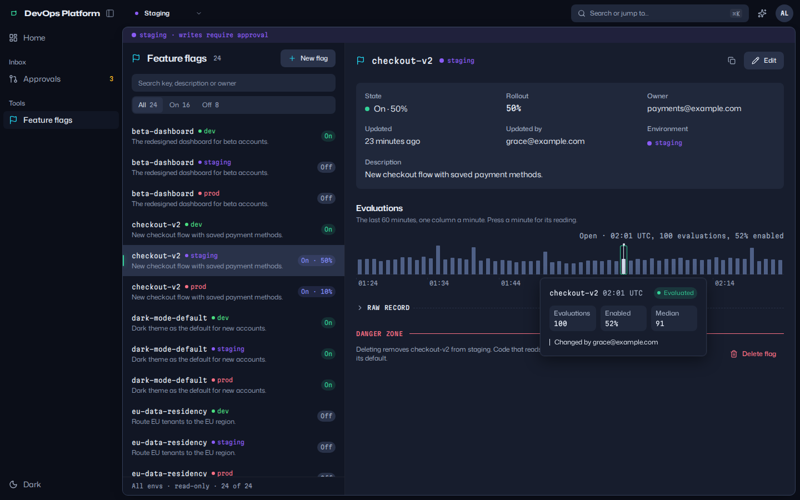
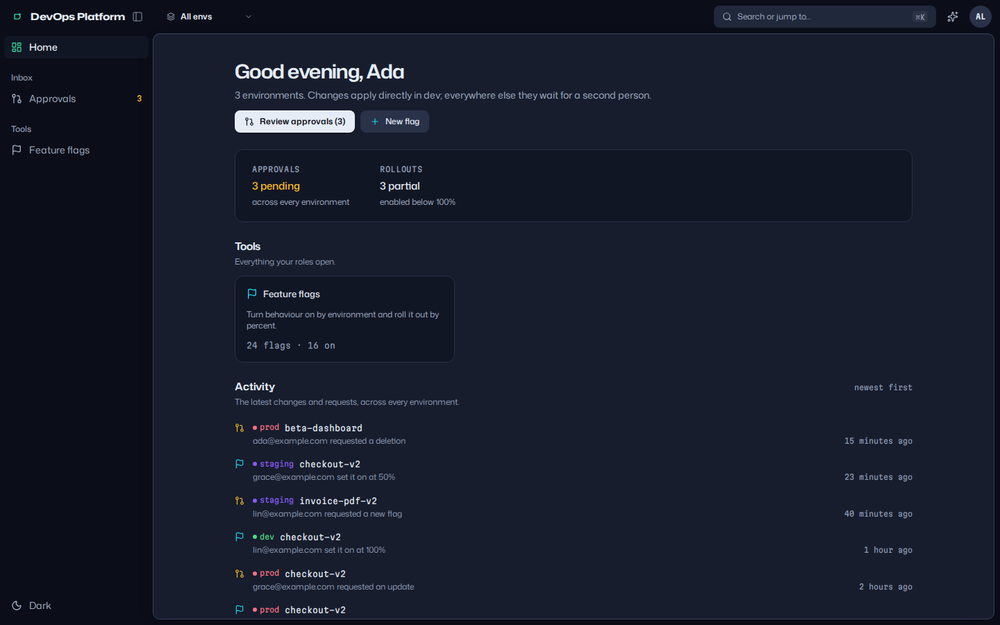
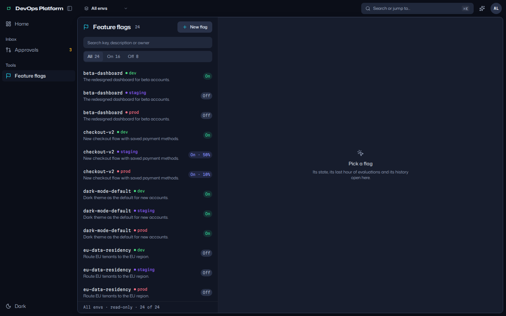
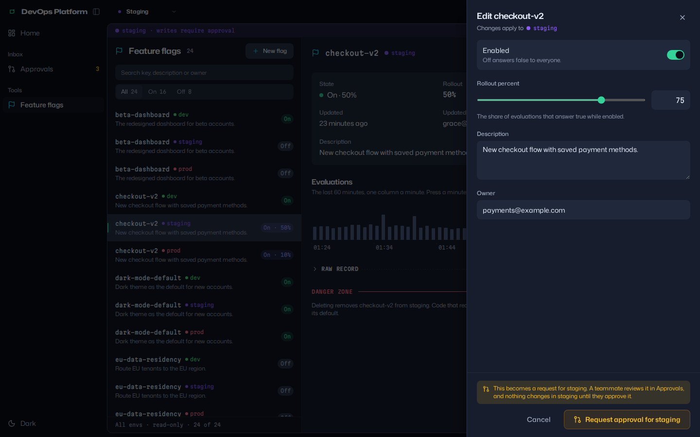
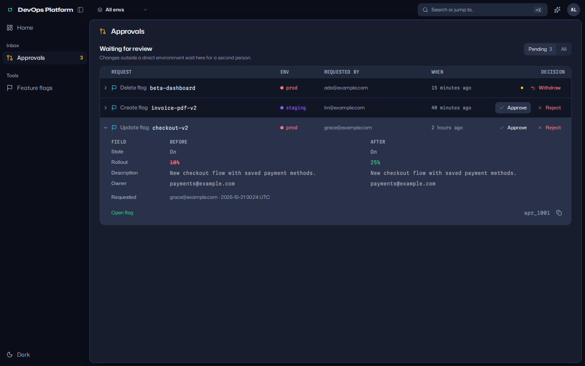
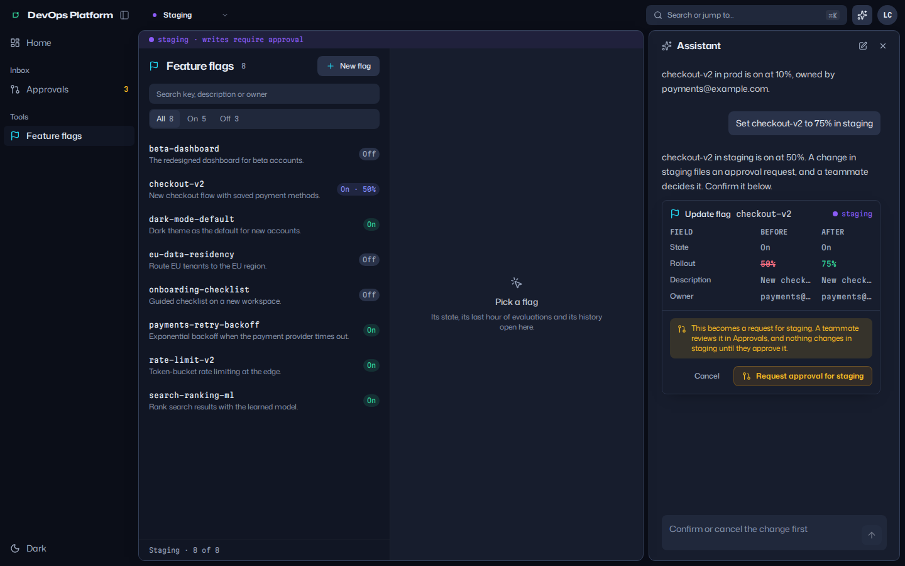
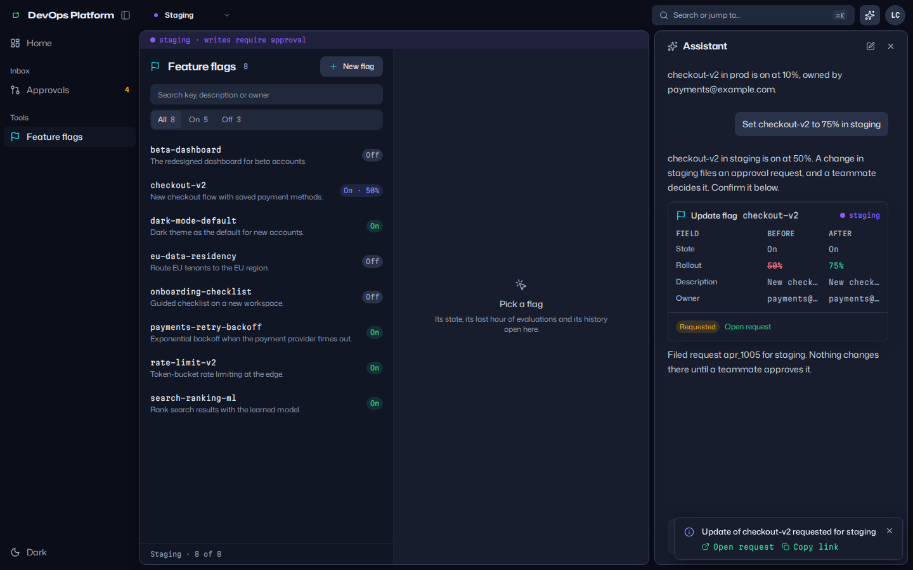
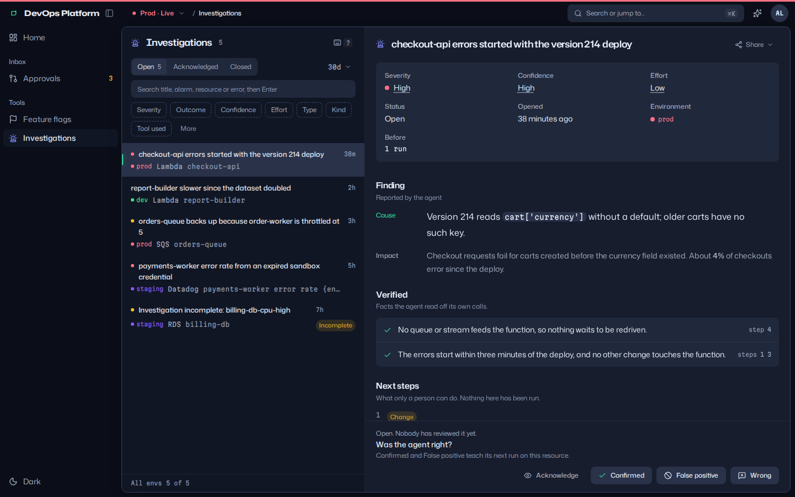
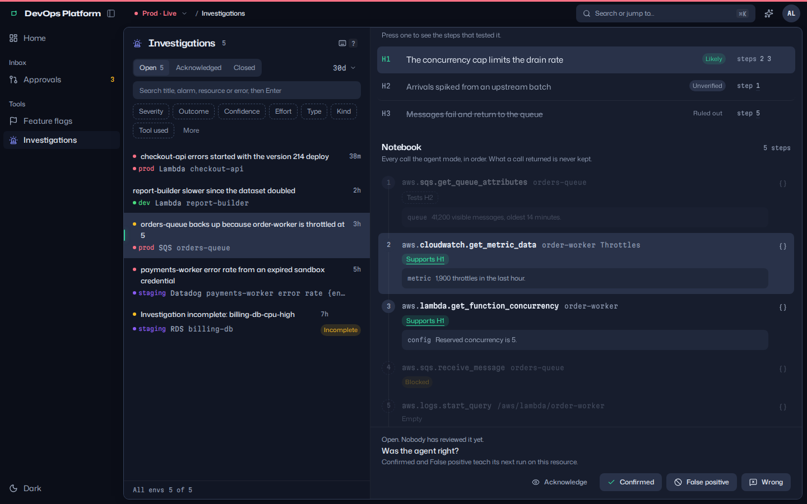
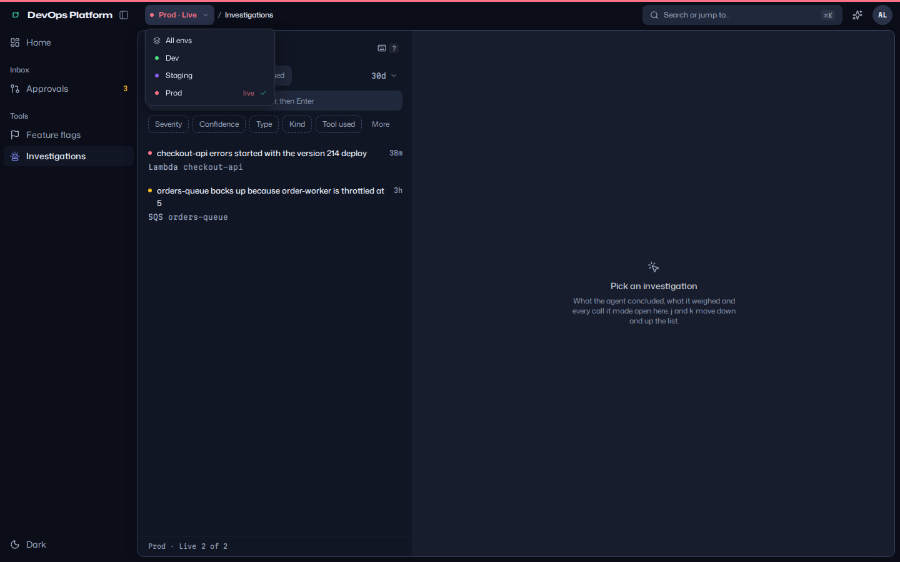

# DevOps Platform

An opinionated starter for internal operations consoles, with approvals and AI
built in. Every tool you add gets the same frame: resources per environment,
scope-based permissions, an admin "view as", a two-person rule for every
change outside the direct environments, and an assistant and an MCP server that
act as the signed-in person and nothing more.

It is two halves and one contract: a FastAPI backend in `backend/`, a React
console in `frontend/`, and `CONTRACT.md` between them. Feature flags are the
example tool, built the way every tool should be.

<picture>
  <source media="(prefers-color-scheme: light)" srcset="docs/screens/flag-detail-minute-popover-light.png">
  
</picture>

## The screens

**Home.** What needs you, the tools your roles open, and the latest changes
and requests across every environment.

<picture>
  <source media="(prefers-color-scheme: light)" srcset="docs/screens/home-light.png">
  
</picture>

**A tool's list.** One row recipe, environment as a quiet signal, the fact on
the right in one word.

<picture>
  <source media="(prefers-color-scheme: light)" srcset="docs/screens/flags-list-all-envs-light.png">
  
</picture>

**A change outside dev.** The sheet says what will happen before you press
anything: an amber "Request approval for staging" and the reason.

<picture>
  <source media="(prefers-color-scheme: light)" srcset="docs/screens/flag-edit-staging-approval-light.png">
  
</picture>

**Approvals.** The inbox shows each request with its before and after; approve
is one press, reject needs a note, nobody reviews their own.

<picture>
  <source media="(prefers-color-scheme: light)" srcset="docs/screens/approvals-inbox-light.png">
  
</picture>

**The assistant.** Reads run at once. A write is a proposal with its diff and
the same confirm the sheets use; confirmed outside dev, it becomes an approval
request like any other.

<picture>
  <source media="(prefers-color-scheme: light)" srcset="docs/screens/assistant-interrupt-staging-light.png">
  
</picture>

<picture>
  <source media="(prefers-color-scheme: light)" srcset="docs/screens/assistant-confirmed-light.png">
  
</picture>

**Investigations.** What an alarm-investigating DevOps agent concluded about
each alarm, for a person to review: the cause and its impact, the facts it
verified, the next steps only a person can take, the hypotheses it weighed and
a notebook of every call it made. A reviewer acknowledges a finding or closes
it with a verdict on how the agent did.

<picture>
  <source media="(prefers-color-scheme: light)" srcset="docs/screens/investigation-detail-light.png">
  
</picture>

<picture>
  <source media="(prefers-color-scheme: light)" srcset="docs/screens/investigation-hypothesis-focus-light.png">
  
</picture>

**The environment.** The top bar says where you are as a path, and the
environment is a crumb of its own in its own colour; pressing it picks another.
A 3px line along the top of the window carries the same colour.

<picture>
  <source media="(prefers-color-scheme: light)" srcset="docs/screens/env-breadcrumb-menu-light.png">
  
</picture>

The screens are taken by `frontend/scripts/screenshots/sweep.ts` in MSW mode
(`PASSES=scenes OUT=../docs/screens bun run screenshots`).

## Quick start

Backend, in dev mode (every request is `ada@example.com`, an admin; an
in-memory store seeded with example flags, pending requests and findings):

```bash
cd backend
uv sync --all-extras
uv run uvicorn platform_api.main:app --reload --port 8000
```

Frontend, against that backend or with no backend at all:

```bash
cd frontend
bun install
bun run dev                      # http://localhost:5173, proxies the API to :8000
                                 # or http://localhost:5173/?msw=1 for the in-browser mock
```

In MSW mode `?as=admin|editor|reviewer|viewer|empty` picks who you are and
`?assistant=off` shows a deployment without the assistant. Against the real
backend the assistant appears when it runs with `AGENT_MODEL` set.

## Stack

| Half     | What                                                                                       |
| -------- | ------------------------------------------------------------------------------------------ |
| Backend  | Python 3.15, FastAPI 0.156, Pydantic 2.14, FastMCP 4.1, Pydantic AI 2.58 (AG-UI), boto3, uv |
| Frontend | React 19.3, TypeScript 7, Vite+ 1.3 (Vite 8, Vitest 5, Oxlint, Oxfmt), Tailwind CSS 4.3, Base UI 1.9, TanStack Query 5 and Router 1, Zustand 5, zod 4, MSW 3, Storybook 10, Bun |
| Fonts    | Mona Sans, Hubot Sans and Martian Mono from Fontsource                                     |
| Storage  | In memory, or one DynamoDB table                                                           |
| Auth     | Dev mode, or any OIDC provider (bearer ID tokens)                                          |

## How the halves fit

`CONTRACT.md` is the agreement, written for people. The backend generates the
machine forms from its code: `backend/openapi.json` and `scope-contract.json`
(the scope vocabulary, the seeded roles and conformance cases). The frontend
generates its types and its copy of the scope contract from them, and both
halves fail their checks when a generated file is stale. A change to a route,
a model, a scope or a role is one change across all of them.

- `backend/README.md`: running, configuration, auth, approvals, MCP and the
  assistant, adding a tool on the backend.
- `frontend/README.md`: scripts, stack, MSW mode, the registry.
- `frontend/DESIGN.md`: the visual language and the eight component standards
  the tests enforce.

## Investigations

The second tool is the review side of an alarm-investigating DevOps agent: an
agent that investigates each CloudWatch alarm or Datadog monitor when it fires,
using read-only tools, and records a structured finding in a DynamoDB table in
each environment. The console reads those findings and writes only their review
fields, so a person can work through them:

- the list shows one review state (open, acknowledged, closed) over a window,
  with search, facets (severity, outcome, confidence, effort, resource type,
  kind, tool used, model, and on the closed tab resolution and reviewer), and
  the findings triage recorded without investigating only when asked;
- a finding shows the agent's cause and impact, the facts it verified, the next
  steps only a person can take (commands to copy, never run), the hypotheses it
  weighed, and a notebook of every call it made with what it read off each one;
- acknowledging says somebody is looking at it; closing records a verdict:
  `confirmed` or `false_positive` (the agent learns from both on its next
  investigation of the resource), `wrong` (needs a note; used only for evals)
  or `dismissed` (for a finding that reported no cause).

A review is a verdict on the agent's own record and changes nothing the
finding is about, so it applies at once in every environment and never becomes
an approval request. Closing keeps the finding, and its eval snapshot, for a
year; acknowledging keeps it 90 days, as the agent's retention contract says.
Reading takes `findings:read` and reviewing `findings:review`, per environment.
Keys: `j` and `k` walk the list, `/` searches, `a` acknowledges, `c` closes,
`h` steps through the hypotheses, `?` lists them.

## Environments in the URL

The environment is part of every link: the shell's `env` search parameter on a
list (absent means every environment the person can read), or the env in the
path of a single item (`/flags/staging/checkout-v2`,
`/investigations/prod/f-checkout-0001`). The top bar names it as a breadcrumb,
`App / environment / Tool`, and a line along the top of the window takes its
colour. Only the person changes it, from the breadcrumb or with ⌥0 (every env)
and ⌥1 onwards; nothing switches it for them. Every environment stays in the
menu: one the open tool cannot show, or one the person cannot read there, is
greyed with the reason, never hidden. On a flag's page another environment opens
the same flag there; on an investigation it returns to the list in the
environment picked. Tools tied to no environment (Home, Approvals) say so in a
crumb that cannot be pressed. The strip saying "writes require approval" shows
for the tools whose writes become approval requests, in the environment on
screen.

## Use it in your own app

`registry.json` makes this repository a
[shadcn GitHub registry](https://ui.shadcn.com/docs/registry/github): install
the design system piece by piece, the whole console, or the agent skills.

```bash
npx shadcn@latest list bkovaluk/devops-platform
npx shadcn@latest add bkovaluk/devops-platform/fold
npx shadcn@latest add bkovaluk/devops-platform/app-shell
npx shadcn@latest add bkovaluk/devops-platform/agent-rules
```

The items, what each installs and what a target app needs are in
`frontend/README.md`.

## Skills for coding agents

`.claude/skills/` holds Claude Code skills grounded in this repo's paths and
commands; `AGENTS.md` points at them. The `agent-rules` registry item installs
them into another project.

| Skill                 | For                                                            |
| --------------------- | -------------------------------------------------------------- |
| `add-tool`            | a new tool end to end, backend and frontend                    |
| `add-approval-action` | an action behind the two-person rule on both halves            |
| `ai-actions`          | exposing an action to MCP and the assistant safely             |
| `api-contract`        | changing the contract and regenerating every artifact          |
| `design-standards`    | building or reviewing UI against the standards and ratchets    |
| `screenshot-sweep`    | both themes at four widths, failing on errors and overflow     |

## Licence

MIT. See `LICENSE`.
